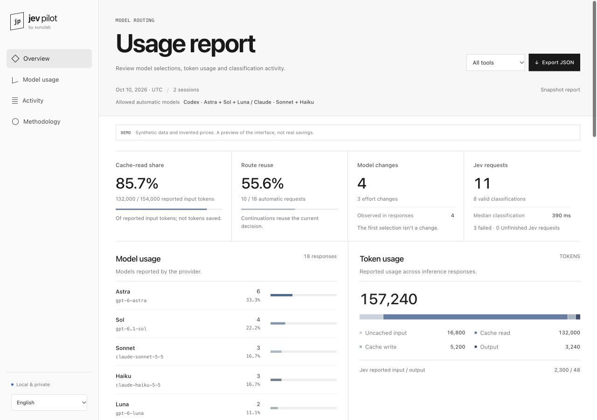
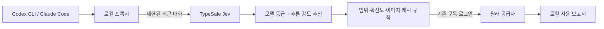

# Jev Pilot

**Codex CLI·Claude Code에서 작업에 따라 모델과 추론 강도를 선택합니다.**

[](https://github.com/sunu-dev/jev-pilot/actions/workflows/ci.yml)
[](LICENSE)
[](docs/compatibility.md)

[English](README.md) · [설치와 검증](#설치와-검증) · [설정](docs/configuration.md) · [오류 진단](docs/troubleshooting.md)

쓰던 CLI와 구독 로그인을 유지합니다. 사용할 모델 범위를 정하면 TypeSafe Jev가 새 사용자 요청마다 모델 등급과 추론 강도를 추천하고, 선택 이유와 관측한 사용량을 로컬 보고서에 남깁니다.

```sh
pilot-codex --models astra,sol
pilot-claude --models opus,sonnet
jev-pilot report --open
```

| 직접 정하는 것 | 확인할 수 있는 것 |
| --- | --- |
| 실행별·프로젝트별 허용 모델 | 원래 추천, 적용 규칙과 최종 모델·추론 강도 |
| 모델 하나를 쓸 때도 추론 강도 자동 선택 | 모델 변경, 선택 재사용, 분류 호출·실패 수 |
| 한국어·영어·일본어·중국어 요청 끝의 모델 지정 | 실제 응답 모델, 토큰·캐시 사용량과 확인 범위 |
| 이미지 작업의 최소 등급과 분류 호출 상한 | 특정 선택에 연결한 로컬 사용자 평가 |



**가상 데모입니다.** 활동과 단가는 예시이며 실측 절감률이 아닙니다. [오프라인 데모 만들기](#보고서-확인) · [계산 방법](docs/reporting.md).

**실험적 알파 버전입니다.** alpha.4에서 작성자 계정의 두 CLI로 짧은 연결 검증은 완료했지만, 장기 세션 안정성·작업 품질·구독 한도 절감은 입증하지 않았습니다. 실제 긴 Codex 세션에서 반복된 스트림 중단이 발생해 조사 중입니다. alpha.5의 진단 기능 추가가 해결을 뜻하지는 않습니다. [검증 범위와 한계](docs/compatibility.md) · [응답 중단 진단](docs/troubleshooting.md).

## 설치와 검증

**Node.js 22 이상**, macOS/Linux, PATH에 등록되어 구독 로그인으로 동작하는 `codex` 또는 `claude`가 필요합니다. Codex 데스크톱 앱의 대화에는 적용되지 않습니다. Jev 분류에는 잔액이 있는 TypeSafe API 키가 필요하며, 이 구독 사용 방식에 별도 OpenAI·Anthropic API 키는 필요하지 않습니다. 모델 접근 권한은 계정과 CLI에 따라 다릅니다.

**1. 고정 버전 패키지를 설치하고 오프라인 검사를 실행합니다.**

```sh
npm install --global https://github.com/sunu-dev/jev-pilot/releases/download/v0.1.0-alpha.5/sunulab-jev-pilot-0.1.0-alpha.5.tgz
jev-pilot verify
```

`jev-pilot`, `pilot-codex`, `pilot-claude`가 추가됩니다. 원래 `codex`, `claude`와 기존 `jev-codex`도 계속 사용할 수 있습니다.

**2. TypeSafe 키 파일 경로를 등록하고 환경을 확인합니다.**

원본 키를 **저장소 밖의 본인만 읽을 수 있는 파일**에 저장한 뒤 경로만 등록합니다.

```sh
jev-pilot init --key-file /absolute/path/to/typesafe-key.txt
jev-pilot doctor
```

환경변수 `TYPESAFE_API_KEY`, `JEV_API_KEY`도 지원합니다. 실제 키를 명령 인수·추적 파일·공개 이슈에 넣지 마세요. `doctor`는 유료 호출 없이 환경을 검사하며 모델 권한을 증명하지 않습니다. CLI가 여러 위치에 설치되어 있다면 [원래 실행 파일을 지정](docs/configuration.md#choosing-the-original-cli)할 수 있습니다.

**3. 사용할 도구를 짧은 실제 프롬프트로 검증합니다.**

```sh
jev-pilot verify --live codex
# Claude Code를 쓰면: jev-pilot verify --live claude
```

TypeSafe 잔액과 공급자 사용량을 소비합니다. Jev 분류 성공뿐 아니라 **공급자 응답 완료와 선택한 모델의 실제 응답**까지 확인해야 PASS입니다. 분류 실패 후 기본값으로 처리한 경우는 통과하지 않습니다. 선택 사항인 `jev-pilot verify --live all --models`는 전역 설정의 모델마다 검사하므로 유료 호출이 늘어납니다.

**4. 프로젝트에서 시작하고 보고서를 엽니다.**

```sh
cd /path/to/project
pilot-codex
# 또는: pilot-claude
```

다른 터미널에서 `jev-pilot report --open`을 실행하면 그때까지 기록한 보고서가 열립니다. 모든 로컬 프로젝트의 실행을 합산하며 `--agent`, `--since`로 범위를 좁힐 수 있습니다. 갱신하려면 명령을 다시 실행합니다. 원래 동작이 필요하면 일반 `codex`, `claude`로 실행하면 됩니다.

<details>
<summary>개발용 소스 설치</summary>

```sh
git clone https://github.com/sunu-dev/jev-pilot.git
cd jev-pilot
npm run verify
node bin/jev-pilot.mjs install
```

소스 설치는 `~/.local/bin`에 실행 명령을 연결합니다. 해당 경로가 PATH에 있어야 하며 소스 폴더를 유지해야 합니다. 기존 명령을 덮어쓰지 않습니다. 설치 없이 사용하려면 `jev-pilot` 대신 `node /path/to/jev-pilot/bin/jev-pilot.mjs`를 실행합니다.

</details>

## 사용할 모델 범위 지정

```sh
pilot-codex --models astra,sol       # 아스트라 + 솔
pilot-codex --models sol             # 솔만, 추론 강도는 자동
pilot-codex --models luna            # 루나만
pilot-codex --models astra,sol,luna   # 세 모델 모두
pilot-codex --models astra,luna       # 솔 제외
pilot-claude --models sonnet,haiku
```

자동 선택과 분류 실패 시의 기본 선택은 이 범위 안에서 이루어집니다. 제외한 등급이 추천되면 허용 모델 중 그보다 높은 등급, 없으면 최고 등급을 씁니다. 아스트라 + 루나에서 솔이 추천되면 아스트라를 선택합니다. 모델을 하나만 허용해도 지원되는 추론 강도 선택에 Jev를 호출하므로 분류 비용은 발생합니다. `--models`와 원래 CLI의 `--model`/`-m`은 함께 쓰지 않습니다.

프로젝트 기본값을 만들려면:

```sh
jev-pilot project init balanced
```

생성한 `.jev-pilot.json`을 아래처럼 편집할 수 있습니다.

```json
{ "codexModels": ["astra", "sol"], "claudeModels": ["opus", "sonnet"], "maxEffort": "high" }
```

실행 시 지정한 범위가 프로젝트 값보다 우선합니다. 비어 있지 않은 범위는 기존 모델 등급 상·하한을 대신하며, 원래 CLI에서 직접 모델을 지정하면 우회할 수 있습니다. 설정은 시작할 때 읽으므로 변경 후 Pilot을 다시 실행합니다. [우선순위와 세부 규칙](docs/configuration.md#automatic-model-scope).

| 프리셋 | 동작 |
| --- | --- |
| `balanced` | 기본 자동 선택, 추론 강도 high까지 |
| `economy` | 어려운 작업도 balanced 등급까지 제한 |
| `quality` | balanced 이상, xhigh 추론 강도 허용 |
| `shadow` | 추천을 기록하고 기본 경로 유지 |

## 요청별 지정과 분류 일시 중지

요청 마지막에 지원하는 명령을 붙입니다.

| 언어 | 예시 |
| --- | --- |
| 한국어 | `아스트라 미디움으로 해` |
| English | `Use Astra medium` |
| 日本語 | `アストラ mediumでお願いします` |
| 中文 | `请用Astra medium` |

해당 요청은 로컬에서 명령을 읽어 Jev 호출 없이 처리하고, 모델 범위와 추론 상한을 지킵니다. 다음 본문 요청부터 다시 자동 선택합니다. 정해진 구문을 인식하는 방식이므로 모든 표현을 이해한다고 보장하지 않습니다. 기본 상한은 **high**이며 xhigh는 설정 상한과 모델 지원이 모두 필요합니다.

실제 이미지가 첨부된 요청은 기본적으로 **strong/high 이상**(기본 Codex 설정에서는 Sol/high)을 사용하되 모델 범위와 추론 상한을 넘지 않습니다. Jev에는 이미지 존재만 전달하고, 원래 공급자에는 이미지를 전달합니다. 조절 가능한 보수적 규칙이며 최적 품질을 입증한 기준은 아닙니다. 요청 끝에서 모델을 명시하면 이미지 최소 기준보다 우선합니다. [요청 명령과 이미지 설정](docs/configuration.md#choose-a-model-at-the-end-of-a-prompt).

```sh
pilot-codex --no-jev --models sol
```

이번 실행만 외부 분류를 끄고 프록시와 로컬 보고서는 유지합니다. 저장된 설정은 바꾸지 않으며, 원래 Codex를 직접 실행하는 것과는 다릅니다. 분류가 연속 실패하면 새 Jev 호출을 잠시 쉬고, 실행별 분류 호출 상한도 설정할 수 있습니다. [분류 장애와 호출 제한](docs/configuration.md#classifier-availability-and-request-limits).

## 보고서 확인

```sh
jev-pilot report --open
jev-pilot report --html report.html
jev-pilot report --json summary.json
jev-pilot report --markdown report.md --agent codex --since 2026-10-10
```

HTML 보고서는 오프라인으로 열리며 한국어·영어·일본어·중국어, 도구 필터, 모델·토큰 구성, 선택 기록과 JSON 내보내기를 지원합니다. 날짜는 UTC 기준입니다. 기존 출력 파일을 덮어쓰지 않으며, `--open`은 본인만 읽을 수 있는 보고서 파일을 만듭니다.

| 관측값 | 자료가 충분할 때 계산하는 추정값 |
| --- | --- |
| 분류 요청·실패·건너뛴 횟수 | 설정한 API 단가로 환산한 모델 비용 |
| 모델·추론 강도 변경과 실제 응답 모델 | 설정한 단가에 따른 Jev 입력 토큰 비용 |
| 토큰·캐시 사용량, 확인 범위와 실패·중단 응답 | **같은 관측 토큰**을 최고 허용 모델에 대입한 비용 차이 |
| 특정 선택에 대한 로컬 사용자 평가 | 구독 한도나 작업 품질은 추정하지 않음 |

단가·사용량이 빠지면 확인 불가로 남기며, 비용 차이가 음수여도 보여줍니다. 캐시 읽기 비중과 선택 재사용률은 **실측 절감률이 아닙니다**. 응답 완료도 작업 정답 여부와 구분합니다. [계산 방법](docs/reporting.md).

선택 기록을 펼치면 원래 추천 → 적용 규칙 → 최종 선택과 연결된 실제 응답 모델을 확인합니다. 여러 프로젝트를 동시에 쓰더라도 특정 결정의 평가 명령을 복사해 실행할 수 있습니다.

```sh
jev-pilot feedback too-weak --decision <decision-id> --agent codex
```

`right`(적절), `too-strong`(과함), `too-slow`(느림), `rework`(재작업 필요)도 지원합니다. 같은 선택을 다시 평가하면 마지막 값만 집계합니다. `--decision`을 생략하면 해당 도구의 모든 로컬 프로젝트 가운데 최근 결정을 평가합니다. 자동 학습·전송은 없으며, 보고서는 명령을 직접 실행하지 않습니다. [평가 설명](docs/reporting.md#inspect-a-decision-and-record-feedback).

소스 폴더에서 키나 네트워크 호출 없이 데모를 만들 수 있습니다.

```sh
npm run demo
open examples/demo-report.html   # macOS; 다른 환경에서는 브라우저로 열기
```

활동과 단가는 모두 가상 자료입니다. GitHub는 HTML을 실행하지 않고 소스를 보여줍니다.

## 동작 방식



새 사용자 요청은 다시 판단하고, 같은 요청의 도구 실행은 경로를 유지합니다. 짧은 승인은 현재 작업을 이어갑니다. 긴 대화의 캐시 때문에 하향을 보류해도 높은 확신의 낮은 등급 추천이 반복되면 내려갑니다. Jev 장애 시에는 정책 안에서 현재·기본 경로를 씁니다. Pilot 자체가 추론 요청을 재시도하지는 않지만 CLI는 재시도할 수 있고, 실패한 요청도 사용량을 소비할 수 있습니다.

Codex 모델 ID와 지원 추론 강도는 로컬 목록으로 검사하지만 계정 권한을 증명하지 않습니다. Claude는 설정된 모델·추론 기능을 사용합니다. 기본 설정은 네 가지 등급을 사용하며 일부 등급은 같은 실제 모델에 연결됩니다. [설계](docs/design.md) · [설정](docs/configuration.md).

## 개인정보와 현재 한계

- 실행기는 임의 포트의 토큰 보호된 `127.0.0.1` 프록시를 씁니다. 구독 요청은 원래 공급자로 보내며, 공급자 주소는 코드에 고정하고 리다이렉트를 거부합니다.
- TypeSafe에는 제한된 최근 대화를 보냅니다. 기본값은 최신 요청 최대 2,000자, 짧은 이전 사용자 요청 두 개와 짧은 답변입니다. 도구 출력·시스템 지시·파일은 추가하지 않습니다. 알려진 비밀 형식은 제거하지만 민감한 문장의 전송을 완전히 막지는 못합니다. 외부 분류가 적합하지 않으면 `--no-jev`를 사용합니다.
- 로컬 로그에는 선택·사용량·제한된 진단 메타데이터를 저장합니다. 대화 원문·도구 출력·인증정보·계정 ID·프로젝트 경로는 기록하지 않습니다. 자동 텔레메트리나 보고서 업로드는 없으며, 분류·API 키는 자식 실행 환경에서 제거합니다. [보안 정책](SECURITY.md).
- 긴 Codex 세션에서 스트림 중단이 발생했습니다. 짧은 새 요청의 성공만으로 해결됐다고 볼 수 없습니다. 이어쓰기·압축·MCP·다중 에이전트 격리는 추가 실제 검증이 필요하며, 적용되는 컨텍스트 한도가 원래 CLI 기본값과 다를 수 있습니다. Windows는 미검증입니다. [호환 범위](docs/compatibility.md) · [진단 방법](docs/troubleshooting.md).
- 통제된 작업 품질·토큰 절감·구독 한도 절감 실험은 아직 없습니다. [검증 계획](docs/validation.md)은 실패·재시도·검토 수정도 비교에 포함합니다.

## 기여와 제거

재현 가능한 설치 오류, 비공개 원문을 제외한 오선택 사례, 호환성 확인, 같은 작업의 비교 평가가 도움이 됩니다. `npm run verify`의 오프라인 검사는 가짜 공급자를 사용하므로 키가 필요하지 않습니다. `npm run eval:routing`은 직접 작성한 사례 형식을 검사하며 작업 품질 검증이 아닙니다. [기여 가이드](CONTRIBUTING.md) · [평가 계획](docs/validation.md).

[이슈](https://github.com/sunu-dev/jev-pilot/issues)에 CLI 버전과 내용을 확인한 요약 보고서를 공유해 주세요. 키·비공개 요청·원본 세션 파일은 올리지 않습니다. 보고서는 자발적으로 공유하며 중앙 수집 기능은 없습니다.

```sh
npm uninstall --global @sunulab/jev-pilot   # npm으로 설치한 경우
# 소스 설치의 실행 명령만 제거: jev-pilot uninstall
```

키 파일·설정·보고서는 보존합니다. 로컬 설정과 데이터를 지우려면 `~/.config/jev-pilot`, `~/.local/share/jev-pilot`를 직접 삭제합니다.

개발자 **sunulab** · Apache-2.0. [Engin Diri의 jev-router](https://github.com/dirien/jev-router) 일부 도우미를 수정해 사용하며 [NOTICE](NOTICE)에 명시합니다. TypeSafe·OpenAI·Anthropic과 독립된 프로젝트입니다.
