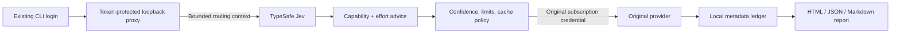

# Jev Pilot

**Automatic model routing you can inspect.**

[](https://github.com/sunu-dev/jev-pilot/actions/workflows/ci.yml)
[](LICENSE)
[](docs/compatibility.md)

[한국어](README.ko.md) · [Demo report](examples/demo-report.html) · [Report methodology](docs/reporting.md) · [Compatibility](docs/compatibility.md)

Jev Pilot runs your existing **Codex CLI or Claude Code**, asks TypeSafe Jev to choose capability and reasoning effort for new user turns, and produces a local report of what happened. It uses the CLI's existing subscription login. A TypeSafe key with available credits is required for classification.

```text
pilot-codex
[Jev Pilot] gpt-6-luna · low (jev)
[Jev Pilot] gpt-6.1-sol · high (sensitive-work)
[Jev Pilot] gpt-6.1-sol · low (cache-hold)
[Jev Pilot] gpt-6-luna · low (sustained-downgrade)
```

Illustrative output. Access depends on your CLI, plan and configured models.

## Why another router?

The question is not just “which model?” It is **“did it switch, why did it stay, and what did that cost?”**

- Model capability and reasoning effort are separate Jev questions in one API call.
- New user turns are reconsidered; tool continuations keep their route.
- A warm, long conversation can hold a downgrade, but repeated confident cheap decisions release it. Sessions do not ratchet upward forever.
- Local reports show Jev requests/failures, selected model and effort changes, served models, cache tokens and estimate coverage.
- Shadow mode records suggestions while keeping the session's default route.
- No runtime dependencies, background daemon, account service or automatic telemetry.

**Experimental alpha.** There is no measured subscription-quota saving or long-session quality benchmark yet. Reports compare API-equivalent prices on observed tokens; they do not claim a smaller subscription bill. See [limitations](docs/compatibility.md).

## Install and verify

Needs Node.js **22+**, a working `codex` and/or `claude` on PATH, and its existing subscription login. Source installation is intended for macOS/Linux. Do not uninstall your original CLI.

```sh
git clone https://github.com/sunu-dev/jev-pilot.git
cd jev-pilot
npm run verify
node bin/jev-pilot.mjs install
```

Installation adds `jev-pilot`, `pilot-codex` and `pilot-claude` to `~/.local/bin`. Add that directory to PATH if necessary. The source directory must stay in place. It does not replace `codex`, `claude`, or an existing `jev-codex`.

Store your **raw TypeSafe key outside this repository** in an owner-readable file. Then register only the file path:

```sh
jev-pilot init --key-file /absolute/path/to/typesafe-key.txt
jev-pilot doctor
```

Alternatively, set `TYPESAFE_API_KEY` or `JEV_API_KEY` in your environment. Do not put a real key in an issue, command argument, screenshot or tracked file. `doctor` makes no paid calls and does not prove model entitlement.

Run the real end-to-end check for the tool you use. This sends a tiny prompt and consumes TypeSafe credits and provider allowance:

```sh
jev-pilot verify --live codex
jev-pilot verify --live claude
# Optional: check every distinct configured model (more paid calls)
jev-pilot verify --live all --models
```

PASS requires a successful Jev decision **and** a completed provider response reporting the selected model. A silent classification fallback does not pass. No installation is required to try: replace `jev-pilot` with `node /path/to/jev-pilot/bin/jev-pilot.mjs`.

Multiple CLI installations? `doctor` shows the versions in use; [select the original executable explicitly](docs/configuration.md#choosing-the-original-cli).

## Use it in a project

```sh
cd /path/to/project
jev-pilot project init balanced
pilot-codex
# or
pilot-claude
```

Project initialization is optional. Plain `codex` and `claude` retain their normal behavior. `pilot-codex -C /path/to/project` reads that project's policy. Project settings contain only routing policy and model IDs, never keys or upstream destinations.

Presets: `balanced` (default), `economy` (up to balanced capability), `quality` (at least balanced, up to xhigh effort), `shadow` (classify and report without applying advice). Economy limits capability even for difficult tasks; pick a suitable preset for your work.

Manual choice: launching with `--model`/`-m` bypasses the proxy. Within a routed session, `/model` requests carrying a real model pass through; selecting Jev Pilot resumes automatic routing. This depends on CLI behavior; see the compatibility matrix.

## Your local report

```sh
jev-pilot report
jev-pilot report --html report.html
jev-pilot report --json summary.json
jev-pilot report --markdown report.md --agent codex --since 2026-10-10
```

Dates use UTC. Output files are created exclusively; existing files are preserved. HTML is a standalone offline file with an agent filter, timeline and JSON export. Open the generated file in a browser. GitHub displays HTML source rather than rendering it.

| Observed metrics | Estimated metrics |
| --- | --- |
| Jev HTTP requests, successes and failures | API-equivalent model cost, if prices are configured |
| Selected model and effort changes; routing reasons | Jev input-token cost, if its rate is configured |
| Served model and usage coverage; incomplete requests | Difference against the configured maximum-tier model on the **same observed tokens** |
| Uncached input, cache reads/writes and output | No subscription-quota or task-quality claim |

Missing prices/usage stay unavailable. Negative differences remain visible. [Configure prices and understand the baseline](docs/reporting.md).

Try the interface without keys or calls:

```sh
npm run demo
open examples/demo-report.html   # macOS; use your browser elsewhere
```

**All demo data and rates are synthetic.**

## How routing works



Defaults have four capability tiers, with `maxEffort: high`. Strong and frontier may share a model; effort is independently selected. Codex's local catalog limits supported effort and checks configured model IDs. The catalog is **not** proof of plan access. Claude capabilities currently use a configured allowlist. [Configuration](docs/configuration.md) · [Design](docs/design.md).

Jev failures keep the current route, or the configured default at session start. Confirmations such as “yes” or “응” inherit the current task. No automatic provider retry is performed by Pilot; your CLI may retry requests. Providers may charge for unsuccessful requests.

## Privacy and credentials

- Requests and subscription credentials pass through a random-port `127.0.0.1` proxy to the original provider. Redirects are refused; upstreams are fixed in code.
- TypeSafe receives up to 2,000 characters of the newest prompt, two short previous user turns and a short previous assistant response. Tool outputs, system instructions and files are not added. Code fences are summarized; recognized secrets are scrubbed. This is **not** a guarantee that sensitive text cannot be sent.
- Logs contain routing metadata, random session/run identifiers, counts and usage. They contain no raw prompts, tool output, provider credentials, account IDs or project paths. Logs stay local and are never automatically uploaded.
- Classifier and API keys are removed from the child environment. This project targets subscription sessions, not BYOK routing.

See [SECURITY.md](SECURITY.md). Review before using on sensitive work.

## Uninstall

```sh
jev-pilot uninstall
```

Removes only source-install launchers still matching the installation manifest. Settings, external key files and local reports are kept. Delete `~/.config/jev-pilot` and `~/.local/share/jev-pilot` manually if you want to discard them. If you installed with npm, use `npm uninstall --global @sunulab/jev-pilot` instead.

## Contribute

Run `npm run verify`. Tests use fake upstreams and require no keys. See [CONTRIBUTING.md](CONTRIBUTING.md) for useful reports, and [our evidence plan](docs/validation.md) for the benchmarks still needed. Please share an aggregate report and CLI versions, not private prompts or raw session files. Reports are opt-in; there is no central collection.

Built by **sunulab**. Apache-2.0. Includes adapted parsing, secret detection and usage helpers from [Engin Diri's jev-router](https://github.com/dirien/jev-router); see [NOTICE](NOTICE). Independent of TypeSafe, OpenAI and Anthropic.
