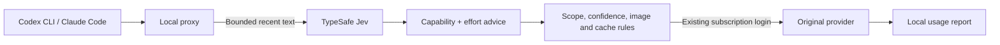

# Jev Pilot

**Task-based model and reasoning-effort routing for Codex CLI and Claude Code.**

[](https://github.com/sunu-dev/jev-pilot/actions/workflows/ci.yml)
[](LICENSE)
[](docs/compatibility.md)

[한국어](README.ko.md) · [Quick start](#install-and-verify) · [Configuration](docs/configuration.md) · [Troubleshooting](docs/troubleshooting.md)

Keep your existing CLI and subscription login. Set the models Pilot may use, let TypeSafe Jev recommend capability and effort for each new user turn, and inspect the choice and observed usage in a local report.

```sh
pilot-codex --models astra,sol
pilot-claude --models opus,sonnet
jev-pilot report --open
```

| You control | You can inspect |
| --- | --- |
| Allowed models, per run or project | Recommended model/effort, applied rules and final choice |
| Automatic effort, even with one allowed model | Model changes, route reuse and classifier calls/failures |
| Trailing model commands in English, Korean, Japanese and Chinese | Provider-reported models, token usage and cache coverage |
| Image-task floors and classifier call limits | Local feedback linked to an exact decision |


**Synthetic demo:** invented activity and prices, not measured savings. [Generate the offline demo](#inspect-a-report) · [Estimate methodology](docs/reporting.md).

**Experimental alpha.** Two short subscription smoke checks completed on the author's accounts in alpha.4; long-session reliability, task quality and subscription-quota savings are not established. Repeated stream interruptions occurred in a long Codex session and remain under investigation. Alpha.5 adds diagnostics; this does not establish a fix. [Evidence and limits](docs/compatibility.md) · [Interrupted responses](docs/troubleshooting.md).

## Install and verify

Requires **Node.js 22+**, macOS/Linux, and a working, subscription-logged-in `codex` and/or `claude` on PATH. Codex desktop sessions are not routed. Jev classification requires a TypeSafe API key with available credits; no separate OpenAI or Anthropic API key is needed for this subscription workflow. Model access still depends on your account and CLI.

**1. Install the pinned alpha package and run offline checks.**

```sh
npm install --global https://github.com/sunu-dev/jev-pilot/releases/download/v0.1.0-alpha.5/sunulab-jev-pilot-0.1.0-alpha.5.tgz
jev-pilot verify
```

This adds `jev-pilot`, `pilot-codex` and `pilot-claude`. Your original `codex`, `claude` and any existing `jev-codex` remain available.

**2. Register your TypeSafe key file and check the setup.**

Save the raw key in an owner-readable file **outside this repository**, then register its path:

```sh
jev-pilot init --key-file /absolute/path/to/typesafe-key.txt
jev-pilot doctor
```

`TYPESAFE_API_KEY` or `JEV_API_KEY` is also supported. Keep real keys out of command arguments, tracked files and issue reports. `doctor` makes no paid calls; it checks setup, not model entitlement. With multiple CLI installations, [choose the executable explicitly](docs/configuration.md#choosing-the-original-cli).

**3. Verify the tool you use with a short live prompt.**

```sh
jev-pilot verify --live codex
# Or: jev-pilot verify --live claude
```

This consumes TypeSafe credits and provider allowance. PASS requires a successful Jev decision **and** a completed provider response reporting the selected model. A fallback alone does not pass. Optional `jev-pilot verify --live all --models` checks each distinct globally configured model and makes more paid calls.

**4. Start a project and open the local report.**

```sh
cd /path/to/project
pilot-codex
# Or: pilot-claude
```

In another terminal, run `jev-pilot report --open`. It aggregates all local project runs; narrow it with `--agent` or `--since`. It opens a snapshot of the records available then; run it again to refresh. Use plain `codex` or `claude` whenever you want their native behavior.

<details>
<summary>Install from source for development</summary>

```sh
git clone https://github.com/sunu-dev/jev-pilot.git
cd jev-pilot
npm run verify
node bin/jev-pilot.mjs install
```

The source installer links launchers into `~/.local/bin`; keep this directory on PATH and retain the checkout. It does not replace existing commands. To try without installing, use `node /path/to/jev-pilot/bin/jev-pilot.mjs` instead of `jev-pilot`.

</details>

## Choose the models Pilot may use

```sh
pilot-codex --models astra,sol       # Astra + Sol
pilot-codex --models sol             # One model, automatic effort
pilot-codex --models luna            # Luna only
pilot-codex --models astra,sol,luna   # All three
pilot-codex --models astra,luna       # Skip Sol
pilot-claude --models sonnet,haiku
```

Scope applies to automatic routing, including fallback. A recommendation for an excluded tier maps upward to an allowed model, or to the highest allowed model. With Astra + Luna, a Sol recommendation uses Astra. A single-model scope still calls Jev for supported effort and adds classifier overhead. Do not combine `--models` with native `--model`/`-m`.

For project defaults:

```sh
jev-pilot project init balanced
```

Then edit `.jev-pilot.json`, for example:

```json
{ "codexModels": ["astra", "sol"], "claudeModels": ["opus", "sonnet"], "maxEffort": "high" }
```

Launch scope overrides project scope. Nonempty scopes replace capability tier bounds; native manual model selection can bypass them. Settings load at launch, so restart Pilot to apply changes. [Scope and precedence](docs/configuration.md#automatic-model-scope).

| Preset | Behavior |
| --- | --- |
| `balanced` | Default adaptive selection; effort capped at high |
| `economy` | Capability capped at balanced, including difficult work |
| `quality` | At least balanced capability; permits xhigh effort |
| `shadow` | Records recommendations while retaining the default route |

## Override a turn, or pause classification

Append a supported command at the end of your request:

| Language | Example |
| --- | --- |
| English | `Use Astra medium` |
| 한국어 | `아스트라 미디움으로 해` |
| 日本語 | `アストラ mediumでお願いします` |
| 中文 | `请用Astra medium` |

These commands are parsed locally, skip Jev for that turn and respect model scope and effort limits. The next substantive user turn returns to automatic routing. Matching is deterministic; every paraphrase is not supported. Default effort is capped at **high**; xhigh requires a higher configured ceiling and model support.

Attached-image requests normally receive a configurable **strong/high floor** (Sol/high in the default Codex map), within your scope and effort ceiling. Jev receives image presence, not pixels; the original provider receives the image. This is a conservative heuristic, not a measured optimum. Explicit trailing model commands take precedence over the image floor. [Prompt commands and image policy](docs/configuration.md#choose-a-model-at-the-end-of-a-prompt).

```sh
pilot-codex --no-jev --models sol
```

This disables external classification for one run while keeping the proxy and local reporting active. Saved settings stay intact. It is not the same as running native Codex. Repeated classifier failures also pause new Jev calls temporarily; an optional per-run cap bounds attempts. [Availability and request limits](docs/configuration.md#classifier-availability-and-request-limits).

## Inspect a report

```sh
jev-pilot report --open
jev-pilot report --html report.html
jev-pilot report --json summary.json
jev-pilot report --markdown report.md --agent codex --since 2026-10-10
```

The standalone HTML report works offline, with English/Korean/Japanese/Chinese text, tool filters, model and token breakdowns, routing history and JSON export. Dates use UTC. Output files do not overwrite existing files; `--open` creates an owner-only snapshot.

| Observed | Estimated, only with sufficient data |
| --- | --- |
| Classifier requests, failures and skips | API-equivalent model cost at configured prices |
| Selected model/effort changes and provider-reported models | Jev input-token cost at a configured rate |
| Token/cache usage, coverage and failed/interrupted responses | Difference against the most capable allowed model, on the **same observed tokens** |
| Local user ratings of individual decisions | No subscription-quota or task-quality estimate |

Missing prices or usage remain unavailable. Negative cost differences remain visible. Cache-read share and route reuse are useful observations, **not measured savings**. Response completion is separate from task correctness. [Calculation details](docs/reporting.md).

Expand a routing decision to inspect recommendation → policy rules → final choice and linked served models. Copy its feedback command to rate that exact decision, including when several projects are running:

```sh
jev-pilot feedback too-weak --decision <decision-id> --agent codex
```

Also accepts `right`, `too-strong`, `too-slow` and `rework`. Corrections replace the previous rating in aggregates. Omitting `--decision` targets the latest decision across all local projects for that tool. Feedback stays local, does not train routing automatically and is never executed by the report. [Feedback details](docs/reporting.md#inspect-a-decision-and-record-feedback).

Try the report without a key or network calls, from a source checkout:

```sh
npm run demo
open examples/demo-report.html   # macOS; use your browser elsewhere
```

All demo activity and rates are synthetic. GitHub displays the HTML source rather than running it.

## How it works



New user turns are reconsidered; matching tool continuations retain their route. Short approvals inherit the current task. Warm-context downgrade holds can release after repeated confident lower-tier recommendations. If Jev fails, Pilot uses the current/default route within policy limits. Pilot does not add inference retries; the CLI may retry, and failed requests may still use allowance.

Codex model IDs and supported effort are checked against its local catalog, which does not establish plan access. Claude uses configured model/effort capabilities. The default map has four capability tiers; some share a physical model. [Design](docs/design.md) · [Configuration](docs/configuration.md).

## Privacy and current limits

- The launcher uses a token-protected random-port `127.0.0.1` proxy. Subscription requests go to the original provider; upstreams are fixed in code and redirects are refused.
- TypeSafe receives bounded recent conversation text: by default up to 2,000 characters of the newest prompt, two short previous user turns and a short assistant response. Tool output, system instructions and files are not added. Recognized secrets are scrubbed, but sensitive text can still be sent. Use `--no-jev` when external classification is unsuitable.
- Local logs store routing, usage and bounded diagnostic metadata, not raw prompts, tool output, credentials, account IDs or project paths. There is no automatic telemetry or report upload. Classifier/API keys are removed from the child environment. [Security policy](SECURITY.md).
- Long Codex sessions have experienced stream interruptions. Fresh short successful checks do not resolve that failure. Resume, compaction, MCP behavior and multi-agent isolation need further live validation; routed context limits can differ from native CLI defaults. Windows is unverified. [Compatibility](docs/compatibility.md) · [Troubleshooting](docs/troubleshooting.md).
- There is no controlled task-quality, token-saving or subscription-quota result yet. The [validation plan](docs/validation.md) keeps failures, retries and review work in the comparison.

## Contribute or remove

Useful contributions are reproducible installation failures, misrouted tasks described without private prompts, compatibility checks and paired task evaluations. Run `npm run verify`; offline checks use fake upstreams and need no keys. `npm run eval:routing` checks the authored case schema, not task quality. See [CONTRIBUTING.md](CONTRIBUTING.md) and the [evaluation plan](docs/validation.md).

Share CLI versions and an inspected aggregate report in [Issues](https://github.com/sunu-dev/jev-pilot/issues). Keep keys, private prompts and raw session files out of public reports. Reports are opt-in; there is no central collection.

```sh
npm uninstall --global @sunulab/jev-pilot   # npm installation
# Or: jev-pilot uninstall                 # source launchers only
```

Removal preserves settings, external key files and reports. Remove `~/.config/jev-pilot` and `~/.local/share/jev-pilot` manually to discard local settings/data.

Built by **sunulab**. Apache-2.0. Includes adapted helpers from [Engin Diri's jev-router](https://github.com/dirien/jev-router); see [NOTICE](NOTICE). Independent of TypeSafe, OpenAI and Anthropic.
